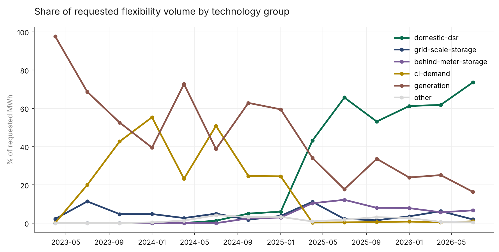
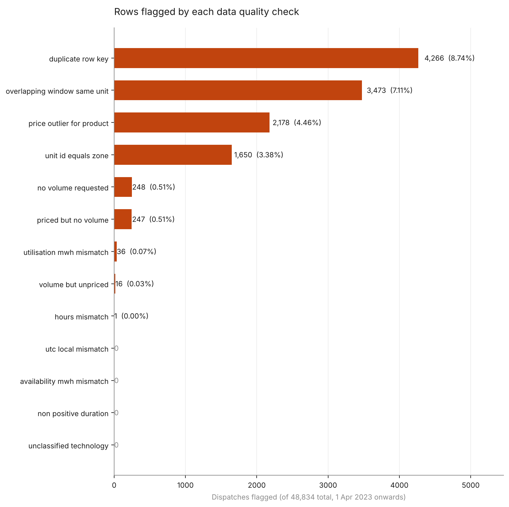

# Who gets dispatched?

https://who-gets-dispatched-2026.streamlit.app/

UK Power Networks publish every flexibility dispatch they've issued since April 2023.
I wanted to use that to answer two questions:

1. Are household assets (EV chargers and heat pumps) winning a bigger share of
   dispatched volume over time, compared with grid-scale batteries?
2. What do they get paid per MWh compared with grid-scale batteries, and does that
   change by product or zone?

Before trusting any numbers I also rebuilt UKPN's own quality checks against the
public data, mainly to make sure I understood what each field meant.



Household DSR (almost all EV chargers) was under 6% of requested volume until early
2025. It jumped to 43% in Q2 2025 and was 74% in the latest quarter (to August 2026),
mostly taking share from generation and C&I demand. Grid-scale batteries stayed small
throughout.


## Data quality

UKPN say every dispatch passes a QC algorithm that checks it is:

- timed within the contracted service window
- assigned to the correct flexibility zone
- not a duplicate
- issued at the contracted price and volume
- matched to an active contract

Three of those need contract data that isn't in the public feed. So `validate.py` runs
the parts I can check from the public data, plus some basic consistency checks
(MWh should equal MW × hours, UTC and local times should agree, and so on).

Some of these checks over-flag at the moment. Duplicates and overlapping windows
account for most of the flags, which makes me think my definition of a unique dispatch
is wrong rather than the data. I'm treating flagged rows as things to look into.




## Requested vs delivered

Everything in this dataset is *requested* volume. UKPN note that delivered volume
depends on performance against a baseline, and they publish outturn separately in the
annual Flexibility Report (data appendices on Tender Hub). So every MWh and £ figure
here is what was instructed. What was actually delivered and paid could be quite
different, and matching the two up is the obvious next step.


## How it works

```
extract    full history via the Opendatasoft /exports endpoint
transform  rename columns, parse timestamps, add settlement periods, group technologies
validate   UKPN's QC criteria where possible, plus consistency checks
analyse    share over time, volume-weighted price, zones, providers, turn-up vs turn-down
figures    the charts in this README
```

A few details:

- **Settlement periods** are counted from local midnight, so clock-change days get 46
  or 50 periods instead of 48. There are tests for both.
- **Prices are volume-weighted.** EV charger dispatches are frequent and tiny, so a
  plain average mostly reflects them and understates what bigger units are paid.
- **Technology groups** are mapped by hand in `TECHNOLOGY_GROUPS`. UKPN use two
  different naming conventions in the same field (e.g. `Battery` and `Stored Energy
  (...)`). Anything not in the mapping comes out as `unclassified` so it's visible.
- **There's no dispatch ID** in the data, so a dispatch is identified by company, unit,
  start time and product.


## Open questions

Things I noticed in an early 2,000-row sample, and what the full extract (48,834
dispatches, April 2023 to August 2026) says:

- **`dispatch_method`** was `epex` in every sampled row. The full history also has
  `email` and `api`, and a handful of rows with free text like `thetford outage nv
  17946` in that field.
- **Turn-up dispatches** (`demand_turn_up`, `generation_turn_down`) show up from 2023,
  not just recently. I need to work out how they relate to UKPN's newer bi-directional
  products.
- **`fu_id` equal to the zone name.** Most unit IDs look like `OCTO-WILL-LTU-F8CF`, but
  1,650 rows use the zone name instead (e.g. `Cobham`). Naming convention or
  placeholder?
- **Older products.** `Dynamic` runs until March 2025 and `Secure` until December 2024,
  before the newer products take over.
- **Availability payments for household assets.** About a fifth of domestic DSR
  dispatches carry an availability price. I want to see which providers and products
  those are.


## Running it

```bash
pip install -e ".[dev]"

python scripts/discover_schema.py   # live field list and sample values
python -m ukpn.pipeline             # pull, tidy, validate, analyse, charts
pytest
streamlit run app.py
```

`python scripts/sql.py` opens a DuckDB shell over the outputs in `data/processed`,
and `notebooks/01_explore.ipynb` has the queries I used while exploring.

Or with Docker:

```bash
docker build -t ukpn-flex .
docker run -p 8501:8501 ukpn-flex
```

Some UKPN datasets need a portal login. If you get a 401 or 403, set `UKPN_API_KEY`.


## Notes

UKPN have an official Python client (`ukpyn`). I wrote a small one instead because I
wanted to understand how the API behaves: `/records` stops at 10,000 rows, so the full
history has to come through `/exports`. If you just want the data, `ukpyn` is easier.

Data © UK Power Networks, published under their open data terms.
